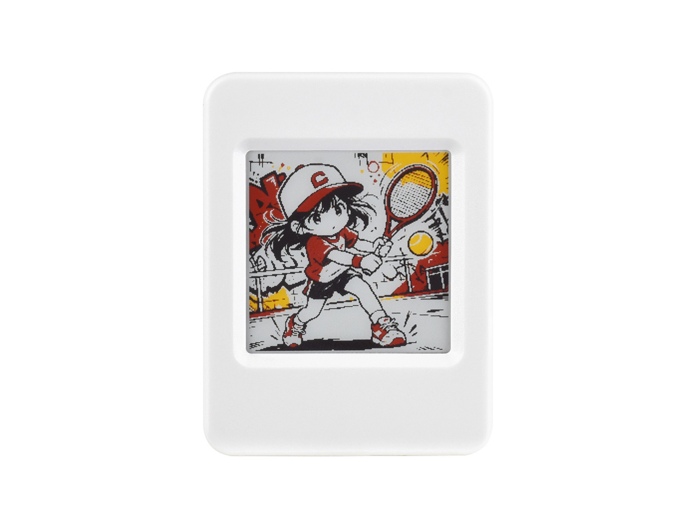

# BacaIn (Waveshare ESP32-S3-ePaper-1.54G)

An ultra-low-power, pocket-sized E-Reader built for the **Waveshare ESP32-S3-ePaper-1.54G** development board, featuring a 1.54-inch 4-color e-paper display, UTF-8 `.txt` book pagination, intelligent deep sleep, and wireless book syncing via a **Web Bluetooth Progressive Web App (PWA)**.



---

## Key Features

- **1.54" 4-Color E-Paper Display (200x200)**: Clean rendering using `Font16` (22 chars/line, 8 lines) or `Font12` (30 chars/line, 11 lines) with battery indicator, book title, and reading percentage.
- **UTF-8 Word-Wrapping & Rolling Page Cache**: Multi-byte boundary protection with a 16-deep rolling offset history for instant backward and forward page turning.
- **Ultra-Low Power & Deep Sleep**: Draws $< 30\ \mu\text{A}$ in deep sleep. Latches board power rail via GPIO 17 (`gpio_hold_en`), cuts e-paper rail via GPIO 6, and wakes instantly on button press (`Ext1`).
- **Web Bluetooth Sync (`/web`)**: Zero app installation required. Connect from any browser with Web Bluetooth (Chrome, Edge, Bluefy) to stream `.txt` books directly to `/sdcard/books/` over 512-byte MTU BLE GATT.
- **Reading State Persistence**: Automatically persists reading progress and bookmarks in `/sdcard/.reader/state.json`.

---

## Repository Structure

```text
.
├── firmware/                      # Production ESP-IDF BacaIn firmware
│   ├── Dockerfile                 # ESP-IDF v5.3.1 reproducible build container
│   ├── build.ps1                  # Docker-first build runner for Windows
│   ├── package_firmware.py        # Factory binary merger & web manifest generator
│   ├── CMakeLists.txt             # Project CMake build definition
│   ├── partitions.csv             # 8MB Flash partition layout
│   ├── sdkconfig.defaults         # Octal PSRAM, NimBLE, and FATFS configurations
│   ├── main/                      # UI state machine, event dispatcher, view renderers
│   └── components/
│       ├── epaper/                # Hardware SPI display driver, fonts, GUI_Paint
│       ├── sdcard/                # 1-line SDMMC host FatFS mount at /sdcard
│       ├── button/                # Multi-button event handler (BOOT & PWR)
│       ├── power_mgr/             # GPIO 17 latch, ADC battery monitor, deep sleep
│       ├── reader_core/           # Text pager, UTF-8 parser, book library & bookmarks
│       └── ble_sync/              # NimBLE GATT service for high-speed file transfer
├── web/                           # Web application for Web Bluetooth sync & Web Serial flasher
│   ├── index.html                 # Modern responsive dashboard & upload UI
│   ├── app.js                     # Web Bluetooth GATT client (0xfe60 profile)
│   ├── style.css                  # Dark/light theme styles
│   ├── manifest.json              # Web app manifest
│   ├── sw.js                      # Offline service worker
│   ├── icon.svg                   # Device vector icon
│   ├── firmware/                  # Firmware distribution manifest
│   │   └── manifest.json          # Web flasher partition metadata
│   └── components/                # Modular web components
│       └── esp-flasher.js         # ESP32-S3 Web Serial flasher (esptool-js)
├── Example/                       # Reference examples (ESP-IDF, Arduino, XiaoZhi AI)
├── Firmware/                      # Factory test binary (01_factory.bin)
└── Hardware/                      # Schematics and mechanical drawings
```

---

## 2-Button Interaction Guide

The board features two hardware buttons: **BOOT (GPIO 0)** and **PWR (GPIO 18)**.

| Screen Context    | Action             | Button            | Function                               |
| :---------------- | :----------------- | :---------------- | :------------------------------------- |
| **Reading View**  | Single Click       | **BOOT (GPIO 0)** | **Next Page**                          |
|                   | Single Click       | **PWR (GPIO 18)** | **Previous Page**                      |
|                   | Double Click       | **BOOT (GPIO 0)** | **Toggle Bookmark**                    |
|                   | Long Press (>1.2s) | **BOOT (GPIO 0)** | **Open Reader Menu**                   |
|                   | Long Press (>1.2s) | **PWR (GPIO 18)** | **Deep Sleep / Power Off**             |
| **Menu View**     | Single Click       | **BOOT (GPIO 0)** | **Move Selection Down** ($\downarrow$) |
|                   | Single Click       | **PWR (GPIO 18)** | **Confirm Selection** ($\checkmark$)   |
|                   | Long Press (>1.2s) | **BOOT (GPIO 0)** | **Back to Reading View**               |
| **Book Library**  | Single Click       | **BOOT (GPIO 0)** | **Next Book**                          |
|                   | Single Click       | **PWR (GPIO 18)** | **Open Book**                          |
|                   | Long Press (>1.2s) | **BOOT (GPIO 0)** | **Back to Menu**                       |
| **BLE Sync View** | Long Press (>1.2s) | **BOOT (GPIO 0)** | **Exit Sync & Return to Reading**      |

_Note: In Reading View, after 60 seconds of inactivity, the reader automatically persists the current byte offset and enters deep sleep to preserve battery._

---

## Quick Start & Build Instructions

### 1. Hardware Preparation

1. Format a MicroSD card as FAT32.
2. Create a `books/` directory on the MicroSD card and copy `.txt` files into it.
3. Insert the card into the MicroSD slot on the ESP32-S3-ePaper board.

### 2. Building & Flashing Firmware

#### Method A: Build via Docker (Recommended - Zero Toolchain Setup)

No local ESP-IDF or Python toolchains required. The build runs in an isolated official `espressif/idf:v5.3.1` container and automatically merges binaries and synchronizes outputs to `web/firmware/`.

**Windows PowerShell:**
```powershell
.\firmware\build.ps1
```

**Docker One-Liner (Linux / macOS / Windows):**
```bash
docker run --rm -v "${PWD}:/project" -w /project/firmware espressif/idf:v5.3.1 \
  bash -c "idf.py set-target esp32s3 && idf.py build && python3 package_firmware.py --web-dir ../web/firmware"
```

**Or using `firmware/Dockerfile`:**
```bash
docker build -t bacain-firmware firmware/
docker run --rm -v "${PWD}:/project" bacain-firmware
```

#### Method B: Native ESP-IDF Build (Local Environment)

Prerequisites: ESP-IDF v5.2 or later (v5.3+ recommended) configured in your environment.

```bash
cd firmware

# 1. Target ESP32-S3
idf.py set-target esp32s3

# 2. Build firmware
idf.py build

# 3. Merge unified factory binary & update web manifest
python3 package_firmware.py --web-dir ../web/firmware
```

#### Flashing Options

- **Web Serial Flasher (No CLI required)**:
  Open `web/index.html` in Chrome/Edge, go to the **Firmware Flasher** tab, and click **Connect & Flash Firmware**.
- **ESP-IDF Serial Flash & Monitor**:
  ```bash
  idf.py -p COM3 flash monitor          # Windows (adjust COM port)
  idf.py -p /dev/ttyUSB0 flash monitor  # Linux / macOS
  ```

### 3. Syncing Books Wirelessly via Web Bluetooth

1. On the reader, open the menu (long press **BOOT**) and select **Sync Books (BLE)**.
2. Open `web/index.html` in any browser supporting Web Bluetooth (Google Chrome, Microsoft Edge, or Bluefy on iOS). You can also serve it via:
   ```bash
   cd web && npx serve
   ```
3. Click **Connect BacaIn** and pair with `BacaIn` (or `Mini-E-Reader`).
4. Drag and drop `.txt` files or click to upload. Files are written directly to `/sdcard/books/` at high speed (~40 KB/s).
5. Manage existing books or delete them remotely directly from the web interface.
6. Long press **BOOT** on the device to exit sync mode and start reading!

---

## Firmware Shipping & Distribution

The BacaIn project provides automated, zero-toolchain firmware installation methods alongside reproducible CI/CD pipelines and manual partition flashing references.

### 1. 1-Click Flashing via Web Serial

Flashing can be performed directly from modern desktop web browsers (Google Chrome, Microsoft Edge, Opera) without installing Python, ESP-IDF, or USB drivers:

1. Connect the ESP32-S3 board to your computer via USB-C.
2. Open the web dashboard at `web/index.html` (e.g., served locally via `npx serve web` or hosted via GitHub Pages).
3. Navigate to the **Firmware Flasher** tab.
4. The flasher automatically checks `web/firmware/manifest.json` and loads the bundled unified factory image (`01_factory.bin`) at offset `0x0`.
5. Click **Connect & Flash Firmware** (or **Flash Firmware Now** if already connected), select your ESP32-S3 serial port in the browser prompt, and monitor real-time progress and serial logs in the console terminal.

### 2. GitHub Actions CI/CD Pipeline & GitHub Releases

Continuous integration and automated shipping are configured via `.github/workflows/firmware_ci.yml`:

- **Triggers**: Automated on pushes/PRs to `main` and version release tags (`v*.*.*`).
- **Build Environment**: Ubuntu runner with Espressif ESP-IDF v5.2+ Docker environment.
- **Artifact Generation**: Compiles bootloader, partition table, and application binaries for the `esp32s3` target with 8MB Flash and Octal PSRAM configurations.
- **Factory Image Packaging**: Merges artifacts into a unified `01_factory.bin` image and synchronizes `web/firmware/manifest.json`.
- **Release Publishing**: Tagged releases automatically generate GitHub Release entries with binary assets (`01_factory.bin`, `bootloader.bin`, `partition-table.bin`, `reader_firmware.bin`) attached for direct download.

### 3. Local Packaging Script (`firmware/package_firmware.py`)

Developers can locally combine ESP-IDF build outputs into a single flashable binary:

```bash
# Execute local packaging helper
python firmware/package_firmware.py
```

Alternatively, invoke `esptool.py` directly:

```bash
esptool.py --chip esp32s3 merge_bin \
  -o Firmware/01_factory.bin \
  --flash_mode dio \
  --flash_size 8MB \
  0x0 firmware/build/bootloader/bootloader.bin \
  0x8000 firmware/build/partition_table/partition-table.bin \
  0x20000 firmware/build/reader_firmware.bin
```

### 4. Flash Memory Partition Offset Table (Manual Reference)

Standard ESP32-S3 partition offsets for 8MB (64Mb) Quad/Octal SPI Flash:

| Partition / Region | Start Offset | Size | Type / SubType | Description |
| :----------------- | :----------- | :--- | :------------- | :---------- |
| **Bootloader** | `0x0000` | 32 KB (`0x8000`) | System | ESP-IDF 2nd stage bootloader (`bootloader.bin`) |
| **Partition Table** | `0x8000` | 4 KB (`0x1000`) | System | Partition map definitions (`partition-table.bin`) |
| **NVS Partition** | `0x9000` | 24 KB (`0x6000`) | `data, nvs` | Non-volatile storage (WiFi/BLE keys, configs) |
| **PHY Init** | `0xF000` | 4 KB (`0x1000`) | `data, phy` | RF calibration and physical layer parameters |
| **Factory App** | `0x20000` | 2.0 MB (`0x200000`) | `app, factory` | BacaIn firmware binary (`bacain.bin` / `reader_firmware.bin`) |
| **Storage (FatFS)** | `0x220000` | 5.81 MB (`0x5D0000`) | `data, fat` | Flash filesystem storage partition |
| **Unified Factory Image** | `0x0000` | ~3.84 MB | Unified Image | Complete pre-merged binary (`01_factory.bin`) |

---

## Hardware Pinout Reference

| Pin Name                         | GPIO           | Function                                   |
| :------------------------------- | :------------- | :----------------------------------------- |
| `EPD_MOSI` / `SCK` / `CS` / `DC` | 13, 12, 11, 10 | SPI2 Host E-Paper Display                  |
| `EPD_RST` / `BUSY` / `PWR`       | 9, 8, 6        | Display reset, busy line, and power switch |
| `SD_CLK` / `SD_CMD` / `SD_D0`    | 39, 41, 40     | 1-line SDMMC MicroSD card interface        |
| `BOOT_KEY` / `PWR_KEY`           | 0, 18          | User input buttons (Ext1 wakeups)          |
| `POWER_HOLD`                     | 17             | Board power latch (must be kept HIGH)      |
| `BATTERY_ADC`                    | 1              | Battery voltage monitoring via ADC1_CH0    |
