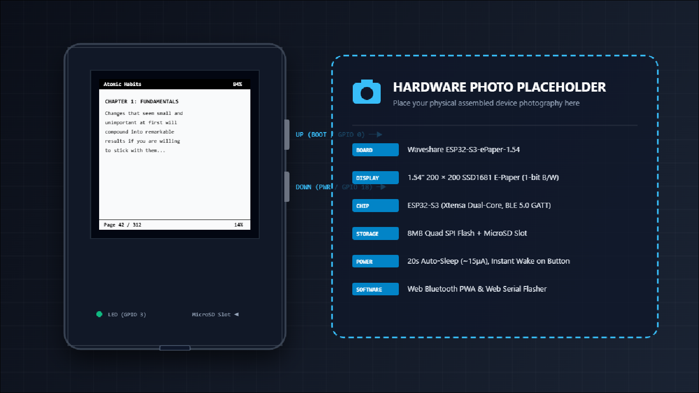
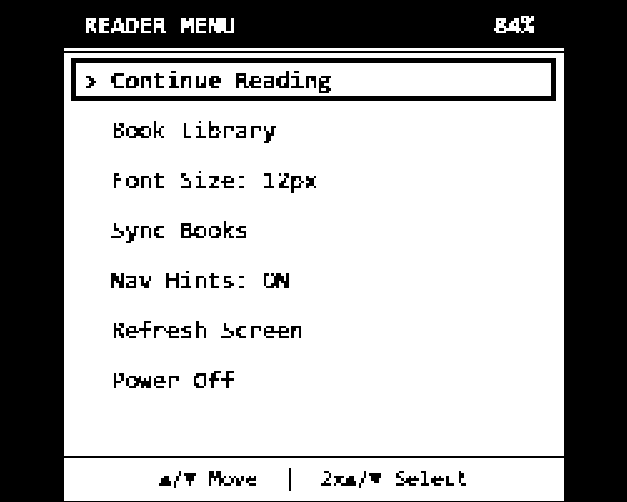
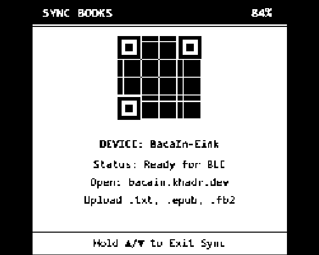
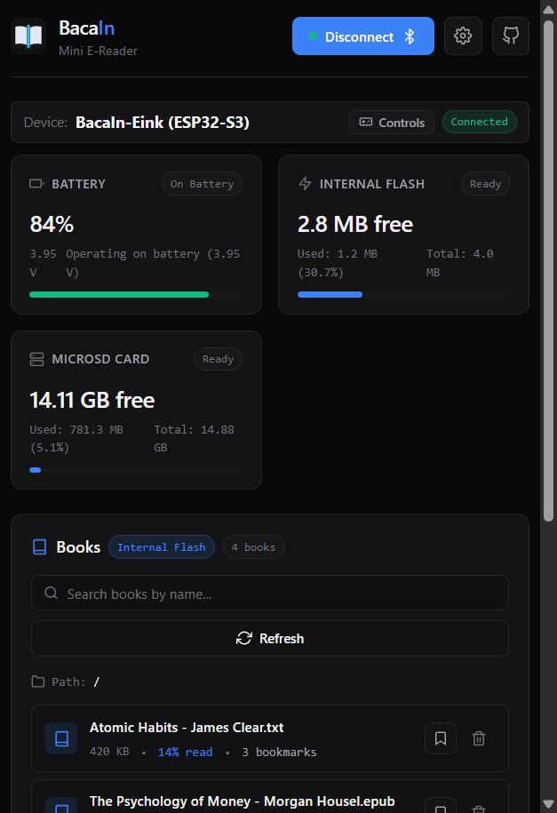
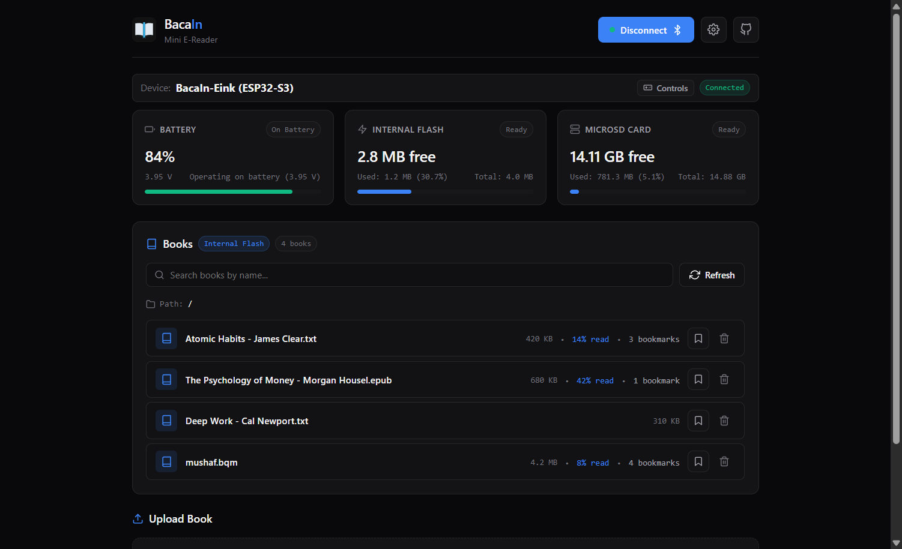
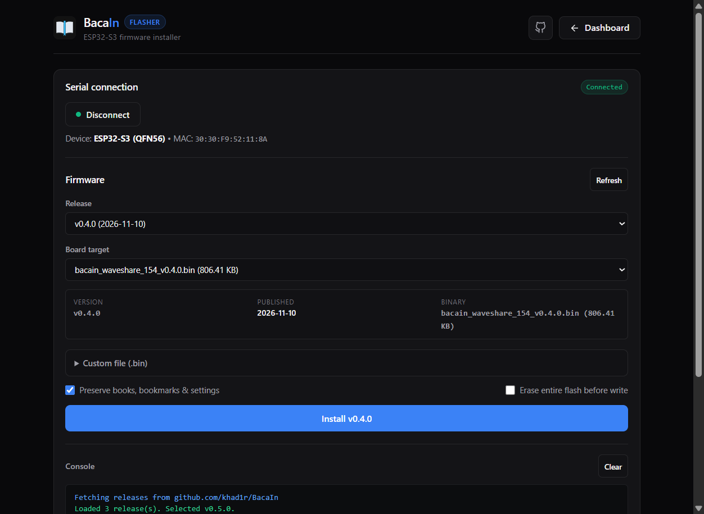

# BacaIn

<div align="center">
  

Mini E-reader firmware for ESP32-S3 e-paper devices with PWA management via Web Bluetooth.

[BacaIn PWA](https://bacain.khadr.dev) | [Web Flasher](https://bacain.khadr.dev/flasher.html)

</div>

Developed on [Waveshare ESP32-S3-ePaper-1.54](https://github.com/waveshareteam/ESP32-S3-ePaper-1.54). See [BOARDS.md](firmware/BOARDS.md) for pinouts and supported board.

> [!note]
> As i don't want the code to be lock for spesific hardware/board, the codebase are configureable ([See BOARDS.md](firmware/BOARDS.md)). although i haven`t test it to other board yet, But pull request are welcome.

## Features

- **Wireless**: Manage device via Web Bluetooth.
- **Formats**: Reads `.txt`, `.epub`, and `.fb2` files.
- **Storage**: Internal flash with optional MicroSD.
- **Power**: 20s auto-sleep, instant page turn on wake.
- **Al-Quran (Optional)**: Offline Mushaf reader (see [firmware/Mushaf_Reader.md](firmware/Mushaf_Reader.md)).

### E-Paper Display Interface

<div align="center">

|                             Reading View                             |                           Reader Menu                            |                           Sync Screen                            |
| :------------------------------------------------------------------: | :--------------------------------------------------------------: | :--------------------------------------------------------------: |
|  |  |  |

</div>

## Controls

Two-button navigation using **UP** (BOOT, GPIO 0) and **DOWN** (PWR, GPIO 18).

<div align="center">
  
  | Context                        | Action               | Button            | Function            |
  | :----------------------------- | :------------------- | :---------------- | :------------------ |
  | **Wake / Start**               | Click                | **UP** / **DOWN** | Wake up             |
  | **Force Reboot**               | Hold together (2.0s) | **UP** + **DOWN** | Force reboot        |
  | **Reading**                    | Click                | **UP**            | Previous page       |
  |                                | Click                | **DOWN**          | Next page           |
  |                                | Double Click         | **UP**            | Toggle bookmark     |
  |                                | Double Click         | **DOWN**          | Open bookmarks list |
  |                                | Hold (>1.2s)         | **UP** / **DOWN** | Open reader menu    |
  | **Menu / Library / Bookmarks** | Click                | **UP** / **DOWN** | Navigate items      |
  |                                | Double Click         | **UP** / **DOWN** | Select or open      |
  |                                | Hold (>1.2s)         | **UP** / **DOWN** | Back / Exit         |
  | **Sync View**                  | Hold (>1.2s)         | **UP** / **DOWN** | Exit sync           |
</div>

## Reader Menu

Access the 7-item menu by holding (>1.2s) UP or DOWN while reading:

1. **Continue Reading**: Resume reading current book.
2. **Book Library**: Browse internal flash and MicroSD books.
3. **Font Size: [12px/16px]**: Toggle text font size between 12px (default) and 16px (saved in NVS).
4. **Sync Books**: Start Web Bluetooth GATT service and show QR code.
5. **Nav Hints**: Toggle footer navigation hints on or off.
6. **Refresh Screen**: Trigger manual full display refresh to clear ghosting.
7. **Power Off**: Display power-off screen and enter deep sleep.

## Quick Start

### Web Companion & Flasher

<div align="center">
  
  |                             Mobile Companion                             |                              Web Dashboard                               |                             Web Serial Flasher                              |
  | :----------------------------------------------------------------------: | :----------------------------------------------------------------------: | :-------------------------------------------------------------------------: |
  |  |  |  |
</div>

### 1. Flash Firmware

Open [bacain.khadr.dev/flasher.html](https://bacain.khadr.dev/flasher.html) in Chrome or Edge, connect the device via USB-C, and flash. To build from source, see [firmware/README.md](firmware/README.md).

### 2. Sync Books

1. On the device, select **Sync Books**.
2. Scan the QR code or navigate to [bacain.khadr.dev](https://bacain.khadr.dev).
3. Connect to the device to upload `.txt`, `.epub`, or `.fb2` files.

## Repository Structure

```text
.
├── .github/
│   └── workflows/          # CI build matrices and GitHub Pages deployment
├── assets/                 # UI screenshots, documentation assets, and hardware photos
├── firmware/               # ESP-IDF firmware source, drivers, and board profiles
│   ├── boards/             # Board definitions, pinouts, and e-paper LUTs
│   ├── components/         # Modular drivers (epaper, ble_sync, power_mgr, reader_core)
│   └── main/               # Application lifecycle, view controllers, and UI state machine
├── web/                    # Companion PWA, text processors, and Web Serial flasher
│   ├── components/         # Custom UI elements (book-uploader, device-manager)
│   ├── processors/         # Ingestion pipeline (epub-processor, fb2-processor, text-cleaner)
│   └── services/           # Web Bluetooth GATT client and storage manager
├── LICENSE                 # CC BY-NC-SA 4.0 license
└── README.md
```

## Acknowledgments

- Paul Lagier (for inspiring me): [I Built a Tiny E-Reader](https://www.youtube.com/watch?v=49U3f7eV1AI)
- Hardware reference: [Waveshare ESP32-S3-ePaper-1.54](https://github.com/waveshareteam/ESP32-S3-ePaper-1.54)
- Serial flashing: [esptool-js](https://github.com/espressif/esptool-js)
- Wireless transfer: [Web Bluetooth API](https://developer.mozilla.org/en-US/docs/Web/API/Web_Bluetooth_API)
