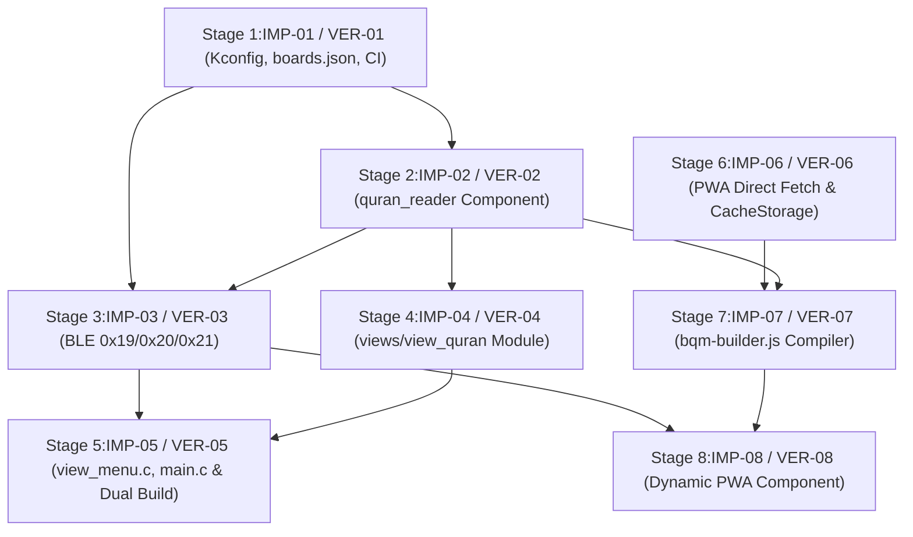

# Al-Quran Subagent Implementation & Verification Ledger (`ALQURAN_SUBAGENTS.md`)

This document defines the strict 1-concern-per-subagent execution plan for [ALQURAN_PLAN.md](./ALQURAN_PLAN.md), enforcing [AGENTS.md](../AGENTS.md) §4:
- **Single Scope per Subagent**: Each implementor handles 1 to 4 files for a single concern.
- **Strict File Isolation**: Editing any file outside `FILE SCOPE` is forbidden.
- **Separation of Concerns**: Implementors (`IMP-XX`) never verify their own work. Every stage is gated by a dedicated independent verifier (`VER-XX`) executing runtime checks without mocks.

---

## Execution Dependency Graph

---

## Stage 1: Board Profile, Kconfig & CI Target (`waveshare_154_alquran`)

### Implementor `IMP-01`
- **Role**: `Build Config Implementor` (`Model: 'flash'`)
- **FILE SCOPE (Max 4 Files)**:
  1. `firmware/components/board_config/Kconfig`
  2. `firmware/sdkconfig.alquran`
  3. `firmware/boards/boards.json`
  4. `.github/workflows/firmware_ci.yml`
- **FORBIDDEN**: All C source files, `CMakeLists.txt`, and `web/*`.
- **Contract**:
  1. In `firmware/components/board_config/Kconfig` (`lines 3-15`):
     - Add `config BOARD_ALQURAN_ENABLE` (`bool "Enable Optional Al-Quran Reader & .bqm Engine"`, `default n`).
     - Do not add a new `BOARD_PROFILE` choice; the edition reuses `BOARD_PROFILE_WAVESHARE_154`.
  2. Create `firmware/sdkconfig.alquran`:
     - Single line `CONFIG_BOARD_ALQURAN_ENABLE=y`. Kconfig symbols must come from this overlay, never from `-DCONFIG_*` flags (`firmware/CMakeLists.txt` maps those to `BOARD_*` compiler macros only).
  3. In `firmware/boards/boards.json` (`lines 1-20`):
     - Append board entry `"id": "waveshare_154_alquran"` with `"flash_size": "8MB"`, `"output_bin": "bacain_waveshare_154_alquran_factory.bin"`, and `"extra_idf_args": "-DCONFIG_BOARD_PROFILE_WAVESHARE_154=y -DSDKCONFIG_DEFAULTS=sdkconfig.defaults;sdkconfig.alquran"`.
  4. In `.github/workflows/firmware_ci.yml` (`line 54`):
     - Update the `jq` matrix generator to use `.extra_idf_args // ("-DCONFIG_BOARD_PROFILE_" + (.id | ascii_upcase) + "=y")`, and quote `"${EXTRA_IDF_ARGS}"`-derived arguments so `;` is not treated as a bash command separator.

### Verifier `VER-01`
- **Role**: `Build Config Verifier` (`Model: 'flash'`)
- **Verification Protocol (Zero-Mock Runtime Execution)**:
  1. Run `jq` against `firmware/boards/boards.json` using the exact expression from `.github/workflows/firmware_ci.yml:54` and verify that both `waveshare_154` and `waveshare_154_alquran` matrix objects are emitted with valid `output_bin` and `extra_args`.
  2. Run two Docker builds (default and `waveshare_154_alquran` args) and assert `build/config/sdkconfig.h` contains `CONFIG_BOARD_ALQURAN_ENABLE 1` only in the Al-Quran build, and `BOARD_DISPLAY_WIDTH`/`HEIGHT` resolve to `200` in both.
  3. Run `git diff --stat` to verify zero files outside `IMP-01` scope were touched.

---

## Stage 2: Dedicated `quran_reader` Component (`.bqm` Parser & NVS State)

### Implementor `IMP-02`
- **Role**: `Quran Reader Component Implementor` (`Model: 'flash'`)
- **FILE SCOPE (3 Files)**:
  1. `firmware/components/quran_reader/CMakeLists.txt`
  2. `firmware/components/quran_reader/include/quran_reader.h`
  3. `firmware/components/quran_reader/quran_reader.c`
- **FORBIDDEN**: `firmware/components/reader_core/*`, `firmware/main/*`, `firmware/components/ble_sync/*`.
- **Contract**:
  1. `firmware/components/quran_reader/CMakeLists.txt`:
     - When `CONFIG_BOARD_ALQURAN_ENABLE` is true, register `SRCS "quran_reader.c"`, `INCLUDE_DIRS "include"`, `REQUIRES nvs_flash epaper board_config`. Otherwise register empty `idf_component_register()`.
  2. `quran_reader.h` & `quran_reader.c`:
     - Define binary packed structs matching [ALQURAN_PLAN.md](./ALQURAN_PLAN.md) §3 (`bqm_header_t`, `bqm_surah_entry_t`, `bqm_ayah_entry_t`, `bqm_word_sprite_t`, `bqm_placed_word_t`) and §5.1 (`quran_state_t`, `quran_bookmark_t`, `quran_layer_t`).
     - Implement zero-allocation functions (no `malloc`, `calloc`, `realloc`, `free`, `strdup`):
       - `esp_err_t quran_reader_init(const quran_state_t *rtc_state)`
       - `bool quran_reader_has_bqm(void)` (checks `/sdcard/books/quran.bqm` and `/spiflash/books/quran.bqm`, validates `"BQM1"` magic and `display_width == BOARD_DISPLAY_WIDTH`, `display_height == BOARD_DISPLAY_HEIGHT`)
       - `const quran_state_t *quran_reader_get_state(void)`
       - `esp_err_t quran_reader_set_cursor(uint8_t surah, uint16_t ayah, uint8_t layer)`
       - `esp_err_t quran_reader_set_bookmarks(const quran_bookmark_t *list, uint8_t count)`
       - `esp_err_t quran_reader_step_page(int8_t dir)` (`+1` next subpage/ayah, `-1` prev subpage/ayah)
       - `esp_err_t quran_reader_cycle_layer(void)` (`MUSHAF -> LATIN -> TRANSLATE -> TAFSIR -> MUSHAF` respecting `layer_mask`)
       - `bool quran_reader_toggle_bookmark(void)` (toggles active `surah:ayah` in `bookmarks[8]`, saves immediately to NVS `"quran"`)
       - `esp_err_t quran_reader_render_subpage(uint8_t *canvas_buf)` (blits 1-bit word sprites for `QURAN_LAYER_MUSHAF` or draws pre-wrapped ASCII lines for `LATIN`/`TRANSLATE`/`TAFSIR`).

### Verifier `VER-02`
- **Role**: `Quran Reader Component Verifier` (`Model: 'flash'`)
- **Verification Protocol (Zero-Mock Runtime Execution)**:
  1. Write a standalone C verification binary in `<appDataDir>/brain/<conversation-id>/scratch/test_quran_reader.c` that generates a real binary `quran.bqm` file on disk (with 2 Surahs, 7 Ayahs, 1-bit word sprites, and all 4 layers) and links `quran_reader.c` + `GUI_Paint.c`.
  2. Execute the binary and assert:
     - `quran_reader_has_bqm()` returns `true` for matching screen dimensions and `false` for mismatched dimensions or corrupt magic.
     - `quran_reader_cycle_layer()` cycles `0 -> 1 -> 2 -> 3 -> 0` while keeping `surah` and `ayah` unchanged and resetting `subpage = 0`.
     - `quran_reader_step_page(+1)` advances across subpages, then increments `ayah`, then wraps to the next `surah`.
     - `quran_reader_toggle_bookmark()` adds and removes bookmarks up to `QURAN_MAX_BOOKMARKS` (`8`).
     - `quran_reader_render_subpage()` writes non-white (`0x00`) pixels into the `5000`-byte canvas buffer at the expected `(x, y)` coordinates without out-of-bounds writes.
  3. Inspect compiled object symbols (`nm` / `objdump -t`) to assert zero references to `malloc`, `free`, `calloc`, `realloc`, or `strdup`.

---

## Stage 3: BLE Capability (`0x19`) & Quran NVS Sync Protocol (`0x20`, `0x21`)

### Implementor `IMP-03`
- **Role**: `BLE Protocol Implementor` (`Model: 'flash'`)
- **FILE SCOPE (3 Files)**:
  1. `firmware/components/ble_sync/CMakeLists.txt`
  2. `firmware/components/ble_sync/ble_sync.h`
  3. `firmware/components/ble_sync/ble_sync.c`
- **FORBIDDEN**: `firmware/main/*`, `firmware/components/quran_reader/*`, `web/*`.
- **Contract**:
  1. In `firmware/components/ble_sync/CMakeLists.txt`:
     - Add `quran_reader` and `board_config` to `REQUIRES`.
  2. In `firmware/components/ble_sync/ble_sync.h`:
     - Define `BLE_SYNC_OP_GET_QURAN_STATE = 0x20` and `BLE_SYNC_OP_SET_QURAN_STATE = 0x21`.
  3. In `firmware/components/ble_sync/ble_sync.c`:
     - In `BLE_SYNC_OP_GET_CONFIG` (`0x19`, `lines 1061-1073`), extend `resp` from `10` to `15` bytes:
       - `resp[10]`: `(CONFIG_BOARD_ALQURAN_ENABLE ? 0x01 : 0x00)`
       - `resp[11..12]`: `BOARD_DISPLAY_WIDTH` (`uint16_le`)
       - `resp[13..14]`: `BOARD_DISPLAY_HEIGHT` (`uint16_le`)
     - Implement `BLE_SYNC_OP_GET_QURAN_STATE` (`0x20`):
       - Under `#if CONFIG_BOARD_ALQURAN_ENABLE`, read `quran_reader_get_state()` and notify the 40-byte payload specified in [ALQURAN_PLAN.md](./ALQURAN_PLAN.md) §4.2. When disabled, return `[0x20, 0x08]`.
     - Implement `BLE_SYNC_OP_SET_QURAN_STATE` (`0x21`):
       - Sub-command `0x01` (6 bytes): call `quran_reader_set_cursor(surah, ayah, layer)` and notify `[0x21, 0x00]`.
       - Sub-command `0x02` (`3 + count * 4` bytes, `count <= 8`): call `quran_reader_set_bookmarks(list, count)` and notify `[0x21, 0x00]`.
     - Verify `BLE_SYNC_OP_START_UPLOAD` (`0x02`) allows `.bqm` filenames alongside `.txt`.

### Verifier `VER-03`
- **Role**: `BLE Protocol Verifier` (`Model: 'flash'`)
- **Verification Protocol (Zero-Mock Runtime Execution)**:
  1. Compile a C packet test harness in `<appDataDir>/brain/<conversation-id>/scratch/test_ble_quran.c` exercising the `0x19`, `0x20`, `0x21`, and `0x02` packet builders/parsers under both `CONFIG_BOARD_ALQURAN_ENABLE=0` and `CONFIG_BOARD_ALQURAN_ENABLE=1`.
  2. Assert:
     - `0x19` response is exactly `15` bytes, `resp[10] == 0x01` when enabled (`0x00` when disabled), and `uint16_le` at `11..14` equals `(200, 200)`.
     - `0x20` response is `40` bytes when enabled and accurately serializes `started`, `surah`, `ayah`, `layer`, `bookmark_count`, and `bookmarks[0..7]`.
     - `0x21` sub-commands `0x01` and `0x02` reject out-of-range `surah` (`0` or `>114`), `layer` (`>3`), or `bookmark_count` (`>8`) with `BLE_SYNC_STATUS_ERROR`, and persist valid mutations immediately.

---

## Stage 4: Quran View Module (`views/view_quran.h` & `views/view_quran.c`)

### Implementor `IMP-04`
- **Role**: `Firmware UI Implementor` (`Model: 'flash'`)
- **FILE SCOPE (2 Files)**:
  1. `firmware/main/views/view_quran.h`
  2. `firmware/main/views/view_quran.c`
- **FORBIDDEN**: `firmware/main/main.c`, `firmware/main/reader_ui.h`, `firmware/main/reader_ui.c`, `firmware/main/views/view_menu.c`, `firmware/components/*`, `web/*`.
- **Contract**:
  1. In `firmware/main/views/view_quran.h` (guarded by `#if CONFIG_BOARD_ALQURAN_ENABLE`):
     - Declare `view_quran_init(bool is_cold_boot)`, `view_quran_save_before_sleep(void)`, `view_quran_enter_menu(void)`, `view_quran_on_wake(reader_view_t view, wakeup_reason_t wakeup)`, and `view_quran_handle_event(reader_view_t view, button_event_t evt)`.
  2. In `firmware/main/views/view_quran.c` (guarded by `#if CONFIG_BOARD_ALQURAN_ENABLE`):
     - Own `RTC_DATA_ATTR static quran_state_t s_rtc_quran_state;` and `RTC_DATA_ATTR` cursor states (`s_rtc_quran_menu_idx`, `s_rtc_quran_jump_idx`, `s_rtc_quran_juz_surah_idx`, `s_rtc_quran_bm_idx`), matching the self-contained module pattern in `firmware/main/views/`.
     - Implement rendering, wake restoration (`view_quran_on_wake`), and 2-button event handling (`view_quran_handle_event`: `1x ▲/▼` -> `quran_reader_step_page`, `2x ▲` -> `quran_reader_cycle_layer`, `2x ▼` -> `quran_reader_toggle_bookmark`, `Hold ▲/▼` -> `VIEW_QURAN_MENU`) for `VIEW_QURAN_MENU`, `VIEW_QURAN_READING`, `VIEW_QURAN_JUMP`, and `VIEW_QURAN_BOOKMARKS` adhering to [ALQURAN_PLAN.md](./ALQURAN_PLAN.md) §5.2:
       - Suppress `0%` progress when `st->started == false` ([AGENTS.md](../AGENTS.md) §2.4).
       - Render `"No Al-Quran data (.bqm)"` / `"Sync via Web Companion"` when `quran_reader_has_bqm() == false`.
       - Use `BOARD_DISPLAY_WIDTH` and `BOARD_DISPLAY_HEIGHT` macros for header (`0..15`), body (`16..H-17`), and footer (`H-16..H-1`).

### Verifier `VER-04`
- **Role**: `Firmware UI Verifier` (`Model: 'flash'`)
- **Verification Protocol (Zero-Mock Runtime Execution)**:
  1. Compile a host C framebuffer test harness linking `view_quran.c`, `reader_ui.c`, `quran_reader.c`, and `GUI_Paint.c`.
  2. Render all views (`VIEW_QURAN_MENU` with and without `.bqm`, `VIEW_QURAN_READING` with `started=false` and `started=true`, `VIEW_QURAN_JUMP`, `VIEW_QURAN_BOOKMARKS`) into a `5000`-byte canvas buffer and exercise `view_quran_handle_event()` transitions.
  3. Assert:
     - When `started == false`, `"0%"` is never drawn on screen.
     - `firmware/main/reader_ui.c` has zero modifications.

---

## Stage 5: Menu Integration, View Dispatcher & Dual-Target Build (`reader_ui.h`, `view_menu.c`, `main.c`, `main/CMakeLists.txt`)

### Implementor `IMP-05`
- **Role**: `Firmware Dispatcher Implementor` (`Model: 'flash'`)
- **FILE SCOPE (4 Files)**:
  1. `firmware/main/reader_ui.h`
  2. `firmware/main/views/view_menu.c`
  3. `firmware/main/CMakeLists.txt`
  4. `firmware/main/main.c`
- **FORBIDDEN**: `firmware/main/reader_ui.c`, `firmware/main/views/view_quran.*`, `firmware/components/*`, `web/*`.
- **Contract**:
  1. In `firmware/main/reader_ui.h` (`lines 20-28`):
     - Under `#if CONFIG_BOARD_ALQURAN_ENABLE`, add `VIEW_QURAN_MENU`, `VIEW_QURAN_READING`, `VIEW_QURAN_JUMP`, `VIEW_QURAN_BOOKMARKS` to `reader_view_t`.
  2. In `firmware/main/views/view_menu.c`:
     - Under `#if CONFIG_BOARD_ALQURAN_ENABLE`, set `MENU_ITEM_COUNT` to `8` (otherwise `7`), insert `"Al-Quran"` at index `2` in `view_menu_render()`, and route double-click on index `2` in `view_menu_handle_event()` to `view_quran_enter_menu(); return VIEW_QURAN_MENU;` (shifting `"Font Size"`..`"Power Off"` to indices `3..7` while keeping `"Continue Reading"` at `0` and `"Book Library"` at `1`).
  3. In `firmware/main/CMakeLists.txt` (`lines 2-28`):
     - Add `"views/view_quran.c"` to `SRCS` and `quran_reader` to `REQUIRES`.
  4. In `firmware/main/main.c`:
     - Under `#if CONFIG_BOARD_ALQURAN_ENABLE`:
       - `#include "view_quran.h"`
       - Call `view_quran_save_before_sleep()` in `app_enter_deep_sleep()` (`line 48`).
       - Add `case VIEW_QURAN_MENU:`, `case VIEW_QURAN_READING:`, `case VIEW_QURAN_JUMP:`, `case VIEW_QURAN_BOOKMARKS:` in `dispatch_wake_view()` (`lines 81-100`) and `dispatch_view_event()` (`lines 102-119`), delegating to `view_quran_on_wake()` and `view_quran_handle_event()`.
       - Call `view_quran_init(is_cold_boot)` in `app_main()` after `book_library_init()` (`line 193`).

### Verifier `VER-05`
- **Role**: `Firmware Build & FSM Verifier` (`Model: 'flash'`)
- **Verification Protocol (Zero-Mock Runtime Execution)**:
  1. Build both firmware targets using ESP-IDF / Docker:
     - Default target: `waveshare_154` (`CONFIG_BOARD_ALQURAN_ENABLE=n`)
     - Al-Quran target: `waveshare_154_alquran` (`-DSDKCONFIG_DEFAULTS=sdkconfig.defaults;sdkconfig.alquran`)
  2. Inspect ELF symbol table (`xtensa-esp32s3-elf-nm build/bacain.elf`) on the default `waveshare_154` build and assert **zero** `quran_reader_*` or `view_quran_*` symbols or `.rodata` exist in the binary ([firmware/RULES.md](./RULES.md) §2.3).
  3. Inspect ELF symbol table and binary size on `waveshare_154_alquran` and verify `package_firmware.py` outputs `bacain_waveshare_154_alquran_factory.bin`.

---

## Stage 6: PWA Direct Fetch & Persistent CacheStorage (`bacain-quran-v1`)

### Implementor `IMP-06`
- **Role**: `Quran Assets Implementor` (`Model: 'flash'`)
- **FILE SCOPE (2 Files)**:
  1. `web/processors/bqm-builder.js`
  2. `web/components/quran-builder.js`
- **FORBIDDEN**: `web/index.html`, `web/app.js`, `firmware/*`.
- **Contract**:
  1. Implement `fetchWithCache(url)` using persistent `globalThis.caches.open('bacain-quran-v1')` with fallback to standard `fetch(url)` if unavailable.
  2. Fetch `.woff2` fonts on-demand from CORS endpoints:
     - `uthmani`: `https://verses.quran.foundation/fonts/quran/hafs/uthmanic_hafs/UthmanicHafs1Ver18.woff2`
     - `indopak`: `https://verses.quran.foundation/fonts/quran/hafs/nastaleeq/indopak/indopak-nastaleeq-waqf-lazim-v4.2.1.woff2`
     and register via browser `FontFace` API.
  3. Fetch and assemble 114-Surah, 6,236-Ayah corpora on-demand from upstream CORS endpoints:
     - Uthmani text (`api.alquran.cloud`) & IndoPak text (`fawazahmed0/quran-api@1`, fallback `api.alquran.cloud`).
     - Latin transliteration, Indonesian & English translations, and Jalalayn tafsirs.
  4. Ensure zero repository or static-site bundle bloat: no binary fonts or multi-megabyte JSON files stored in git or GitHub Pages bundles.

### Verifier `VER-06`
- **Role**: `Quran Assets Verifier` (`Model: 'flash'`)
- **Verification Protocol (Zero-Mock Runtime Execution)**:
  1. Run runtime verification on `fetchWithCache` and `fetchQuranDatasets`:
     - Assert `fetchWithCache` caches responses in `bacain-quran-v1` and serves cached responses on subsequent calls.
     - Assert `surahs.length === 114` and `ayahs.length === 6236`.
     - Assert every ayah has non-empty `uthmaniWords`, `indopakWords`, and `latin`.
     - Assert `.woff2` fonts load via `FontFace` without errors.

---

## Stage 7: Client-Side `.bqm` Binary Compiler (`web/processors/bqm-builder.js`)

### Implementor `IMP-07`
- **Role**: `BQM Compiler Implementor` (`Model: 'flash'`)
- **FILE SCOPE (1 File)**:
  1. `web/processors/bqm-builder.js`
- **FORBIDDEN**: `web/index.html`, `web/app.js`, `web/components/*`, `firmware/*`.
- **Contract**:
  1. Export `renderAyahPreviewToCanvas(canvas, options)` and `buildBqmPackage(options, onProgress)`.
  2. Accept `displayWidth` and `displayHeight` from `options` (never hardcode `200x200`).
  3. Rasterize unique words using browser `OffscreenCanvas` / `<canvas>` with the selected Mushaf font (`0` = Madinah Uthmani, `1` = IndoPak), apply 1-bit thresholding, crop each word to its tight black-pixel bounding box `(width, height, y_offset, stride_bytes, packed_rows)`, and compute RTL `(x, y)` placements per `displayWidth x (displayHeight - 32)` subpage.
  4. Pre-wrap selected `latin`, `translate`, and `tafsir` layers into fixed-width ASCII subpages and pack the complete binary `ArrayBuffer` matching the `BQM1` header and table layout in [ALQURAN_PLAN.md](./ALQURAN_PLAN.md) §3.

### Verifier `VER-07`
- **Role**: `BQM Cross-Platform Verifier` (`Model: 'flash'`)
- **Verification Protocol (Zero-Mock Runtime Execution)**:
  1. Launch Headless Chromium via Puppeteer/Playwright, load `web/processors/bqm-builder.js`, and compile real `.bqm` binaries for:
     - Geometry A: `200x200` (`waveshare_154`), Madinah Uthmani (`style=0`)
     - Geometry B: `296x128` (rectangular display test), IndoPak (`style=1`)
  2. Feed the generated `.bqm` files directly into the compiled C `quran_reader.c` verification binary from Stage 2 (`VER-02`) and assert:
     - `quran_reader_has_bqm()` accepts Geometry A on a `200x200` build and rejects Geometry B on a `200x200` build.
     - Every placed word in every Mushaf subpage satisfies `x + sprite.width <= displayWidth` and `16 <= y + sprite.height <= displayHeight - 16`.
     - Rendering Ayah `1:1` and `2:255` through `quran_reader_render_subpage()` produces valid 1-bit e-paper framebuffers.

---

## Stage 8: Dynamic `<quran-builder>` Web Component & BLE Wiring (`web/`)

### Implementor `IMP-08`
- **Role**: `PWA Quran Component Implementor` (`Model: 'flash'`)
- **FILE SCOPE (2 Files)**:
  1. `web/components/quran-builder.js`
  2. `web/app.js`
- **FORBIDDEN**: `web/index.html`, `web/processors/bqm-builder.js`, `firmware/*`.
- **Contract**:
  1. In `web/app.js`:
     - Add `GET_QURAN_STATE: 0x20` and `SET_QURAN_STATE: 0x21` to `OPCODES`.
     - In `applyDeviceConfigPayload(val)` (`lines 1575-1636`): parse `caps = val.byteLength > 10 ? val.getUint8(10) : 0`, `rawW = val.byteLength >= 13 ? val.getUint16(11, true) : 200`, `rawH = val.byteLength >= 15 ? val.getUint16(13, true) : 200`, compute rotated `(screenW, screenH)`, and when `(caps & 0x01) !== 0`, dynamically `await import('./components/quran-builder.js')`, mount `<quran-builder id="quranBuilder">`, call `qb.setDisplayGeometry(screenW, screenH)`, and query `0x20` (`GET_QURAN_STATE`).
     - When `(caps & 0x01) === 0` or on disconnect (`updateConnectionUI`), remove `#quranBuilder` from the DOM.
     - Wire custom events from `<quran-builder>`: `quran-set-tilawah` (`[0x21, 0x01, ...]`), `quran-set-bookmarks` (`[0x21, 0x02, ...]`), and `file-select` (streams generated `quran.bqm` over existing BLE chunk uploader).
  2. In `web/components/quran-builder.js`:
     - Implement Mushaf Script selector (`Madinah Uthmani Hafs (KFGQPC)` and `IndoPak 15-Line Naskh` only; no custom font upload, no color Tajweed), Layer toggles (`Mushaf`, `Latin`, `Translation`, `Tafsir`), Range selector, dynamic `screenW x screenH` 1-bit live preview `<canvas>`, and Tilawah + 8-Slot Bookmark Manager synced with `0x20`/`0x21`.

### Verifier `VER-08`
- **Role**: `PWA E2E Integration Verifier` (`Model: 'flash'`)
- **Verification Protocol (Zero-Mock Runtime Execution)**:
  1. Launch the PWA in Headless Chromium and inspect network requests and DOM state:
     - **Test 1 (Standard Board `caps = 0x00`)**: Simulate `applyDeviceConfigPayload` with `resp[10] = 0x00`. Assert `#quranBuilder` is absent from DOM and zero HTTP requests were made to `quran-builder.js` or `bqm-builder.js`.
     - **Test 2 (Al-Quran Board `caps = 0x01`, `200x200`)**: Simulate `applyDeviceConfigPayload` with `[0x19, 0x00, 1, 1, 0, 0, 0, 1, 20, 0, 0x01, 200, 0, 200, 0]`. Assert `<quran-builder>` is dynamically imported and mounted, preview `<canvas>` has `width === 200` and `height === 200`, and `0x19` rotation `1` (`90 deg`) resizes a `296x128` board preview canvas to `128x296`.
     - **Test 3 (Bookmark & Tilawah Sync)**: Simulate `0x20` notification payload (`40` bytes), verify UI renders active Surah:Ayah and bookmark list, trigger "Add Bookmark" and "Jump Tilawah" in the DOM, and assert the exact binary payloads `[0x21, 0x01, ...]` and `[0x21, 0x02, ...]` are emitted.
