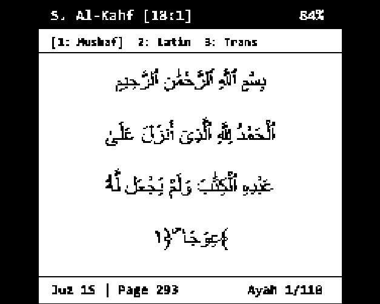
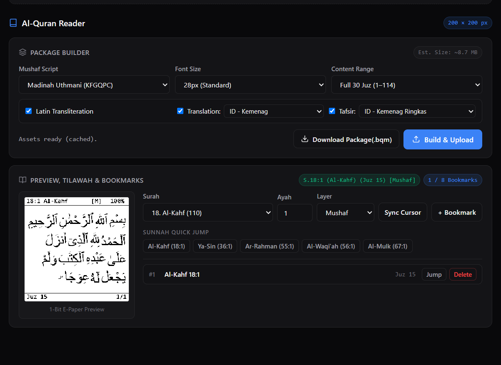

# Mushaf Reader

Optional offline Mushaf reader for BacaIn e-paper devices using pre-rendered `.bqm` packages.

Arabic script requires contextual glyph shaping and ligatures that are heavy for an MCU, so the companion web app pre-renders the Mushaf words into 1-bit bitmaps and packs them with the text layers into a binary file (`mushaf.bqm`) for streaming from flash or MicroSD.

## Features

- **4 Reading Layers**: Mushaf 1-bit word sprites, Latin transliteration, Translation, and Tafsir.
- **Quick Navigation**: Direct jump to Sunnah surahs (Al-Kahf, Yasin, Ar-Rahman, Al-Waqiah, Al-Mulk) and 30 Juz.
- **Bookmarks**: 8 persistent bookmark slots stored in NVS.
- **Same Reading Frame as Books**: header, footer and font size setting are shared with the book reader.
- **Zero Overhead When Disabled**: Mushaf sources compile to nothing when `CONFIG_BOARD_MUSHAF_ENABLE=n`.

<div align="center">
  
</div>

## Build & Flash

Build the factory binary with Docker Compose:

```bash
# From repository root:
docker compose -f firmware/compose.yml run --rm -e BOARD=waveshare_154_mushaf firmware

# Or inside firmware/:
BOARD=waveshare_154_mushaf docker compose run --rm firmware
```

Flash the generated factory binary (`firmware/build/bacain_waveshare_154_mushaf.bin`) at offset `0x0`:

```bash
# Windows
esptool.py -p COM3 -b 460800 --chip esp32s3 write_flash 0x0 build/bacain_waveshare_154_mushaf.bin

# Linux / macOS
esptool.py -p /dev/ttyACM0 -b 460800 --chip esp32s3 write_flash 0x0 build/bacain_waveshare_154_mushaf.bin
```

Binaries can also be flashed via the browser at [bacain.khadr.dev/flasher.html](https://bacain.khadr.dev/flasher.html).

## Controls

Two-button navigation with **▲** and **▼**. The arrows swap when button invert is enabled.

| Context                     | Action       | Button    | Function                                         |
| :-------------------------- | :----------- | :-------- | :----------------------------------------------- |
| **Reading**                 | Click        | **▲**     | Previous page or subpage                         |
|                             | Click        | **▼**     | Next page or subpage                             |
|                             | Double Click | **▲**     | Cycle layer (Mushaf, Latin, Translation, Tafsir) |
|                             | Double Click | **▼**     | Toggle bookmark                                  |
|                             | Hold (>1.2s) | **▲ / ▼** | Open Mushaf menu                                 |
| **Menu / Jump / Bookmarks** | Click        | **▲ / ▼** | Move selection                                   |
|                             | Double Click | **▲ / ▼** | Select or jump                                   |
|                             | Hold (>1.2s) | **▲ / ▼** | Back                                             |

The same table is shown on the device under **Nav Hints**.

## Screens

**Mushaf menu**: `Start Tilawah` or `Resume s:a (Juz n)`, `Layer: [name]`, `Sunnah & Juz Jump`, `Bookmarks (n/8)`.

**Reading** uses the book reader frame:

| Area   | Content                                                                                                                         |
| :----- | :------------------------------------------------------------------------------------------------------------------------------ |
| Header | `surah:ayah Name` on the left, battery on the right                                                                             |
| Body   | Mushaf layer: word sprites. Text layers: wrapped text in the reading font                                                       |
| Footer | Left: `J<juz> <layer>` (`MUS`, `LAT`, `TRN`, `TAF`) and `[BM]` when bookmarked. Right: `subpage/total` and percent of the Quran |

- Text layers follow the **Font Size** setting (12 or 16 px) and are re-wrapped on the device for the current screen and rotation.
- Accented transliteration letters are shown without accents (`ā` → `a`, `ḥ` → `h`, `ʿ` → `'`).
- Page turns use the periodic full refresh setting, like books.
- The cursor is saved to NVS at sleep and on explicit edits (bookmarks, jumps), not on every page turn.

## Companion Web Builder (`mushaf.bqm`)

<div align="center">
  
</div>

1. Connect the device in [BacaIn PWA](https://bacain.khadr.dev). The builder reads the display width and height from the device.
2. Open Mushaf Builder, select script (Madinah Uthmani or IndoPak), layers, and Surah or Juz range.
3. Generate the file and upload it to internal flash (`/spiflash/books/mushaf.bqm`) or MicroSD (`/sdcard/books/mushaf.bqm`).

A package is built for one display size. A package built for another size or format version is rejected at load and logged as `BQM header invalid`; rebuild it in the web builder.

| Target Storage   | Usable Capacity           | Recommended Scope                                   |
| :--------------- | :------------------------ | :-------------------------------------------------- |
| **8 MB Flash**   | ~6.94 MB (`/spiflash`)    | Full 30 Juz (Mushaf + Latin + Translation, ~4.2 MB) |
| **4 MB Flash**   | ~2.94 MB (`/spiflash`)    | Juz 30 ('Amma), custom Surah ranges, or MicroSD     |
| **MicroSD Card** | Card capacity (`/sdcard`) | Full 30 Juz with complete Tafsir (~8.7 MB)          |

Sizes were measured for 200x200 with format version 1; version 2 uses slightly more subpages per ayah.

## Binary File Layout (`mushaf.bqm`, format version 2)

Pre-rendered binary container with signature `"BQM1"` and `version = 2`:

| Section             | Offset               | Purpose                                                                                           |
| :------------------ | :------------------- | :------------------------------------------------------------------------------------------------ |
| **Header**          | `0x0000` (64 B)      | Signature, version, layer mask, script id, display width and height, section offsets, edition tag |
| **Surah Table**     | `0x0040` (2,736 B)   | 114 entries (24 B): surah number, ayah count, first global ayah, start juz, Latin name (18 B)     |
| **Ayah Table**      | `0x0AF0` (149,664 B) | 6,236 entries (24 B): juz, hizb quarter, subpage count per layer, offset per layer                |
| **Word Dictionary** | `word_dict_off`      | Sprite descriptors (8 B): width, height, y offset, row stride, bitmap offset                      |
| **Sprite Blob**     | `sprite_blob_off`    | 1-bit word bitmaps (8 px per byte, MSB first)                                                     |
| **Mushaf Pages**    | `mushaf_pages_off`   | Per ayah: subpage offsets, then per subpage a word count and placed words `(word_id, x, y)`       |
| **Text Blob**       | `text_blob_off`      | Per ayah and layer: subpage offsets, then length-prefixed ASCII lines                             |

Constraints the firmware relies on:

| Item                    | Limit                                                                                           |
| :---------------------- | :---------------------------------------------------------------------------------------------- |
| Sprite size             | width and height up to 255 px                                                                   |
| Words per subpage       | up to 64                                                                                        |
| Sprite placement        | rows `22` to `display_height - 19` (reader body); pixels outside are clipped and logged once    |
| Rotation                | sprites are placed for the board's native orientation; on non-square panels use rotation 0 or 2 |
| Text per ayah and layer | up to 2047 bytes after joining lines (`MUSHAF_TEXT_BUF_MAX`); longer text is cut and logged     |
| Stored text line breaks | ignored; the device re-wraps text for its font and screen                                       |

## BLE Sync Protocol

Mushaf extensions for the BacaIn BLE GATT service (`0000fe60-0000-1000-8000-00805f9b34fb`):

| OpCode | Name               | Payload (Request / Response)                                                                                                         | Purpose                                                   |
| :----- | :----------------- | :----------------------------------------------------------------------------------------------------------------------------------- | :-------------------------------------------------------- |
| `0x19` | `GET_CONFIG`       | Req: `[0x19]`<br>Resp: see README section 7, `caps` includes `BLE_SYNC_CAP_MUSHAF`                                                   | Mushaf support flag and display size for the builder      |
| `0x20` | `GET_MUSHAF_STATE` | Req: `[0x20]`<br>Resp (40 B): `[0x20, status, started, surah, ayah(2B LE), layer, count, bookmarks[8] x (surah, ayah(2B LE), juz)]`  | Query cursor and 8 bookmarks                              |
| `0x21` | `SET_MUSHAF_STATE` | Req: `[0x21, 0x01, surah, ayah(2B LE), layer]` or `[0x21, 0x02, count, count x (surah, ayah(2B LE), juz)]`<br>Resp: `[0x21, status]` | Set cursor (`0x01`) or bookmarks (`0x02`) and save to NVS |

## Acknowledgments

- Mushaf fonts: KFGQPC Uthmanic Hafs (King Fahd Complex) and IndoPak Nastaleeq (QUL), served by quran.foundation
- Uthmani text, transliteration, translations and tafsir: [alquran.cloud](https://alquran.cloud) editions `quran-uthmani`, `en.transliteration`, `id.indonesian`, `en.sahih`, `id.jalalayn`, `en.jalalayn`
- IndoPak text: Fawaz Ahmed `quran-api` (`ara-quranindopak`)
